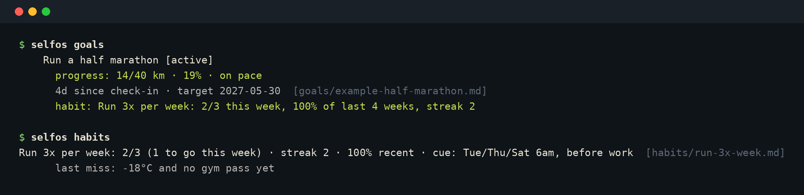

# self.os

**Turn any AI assistant into a goal coach that actually helps you follow through.**

self.os is a plain-text vault your AI agents share: your goals, the habits that drive them,
your reasons, your plans for when things go wrong, plus the context a good assistant needs
(who you are, how you like to work, the people in your life). It ships with a CLI and an
**MCP server**, so Claude, Cursor, OpenClaw and any MCP-capable agent can coach you from
the same files, and your data never leaves your machine.

<p align="center"></p>

## Why it works

It's built around what research on goal pursuit consistently supports, rather than a to-do list:

| Practice | In self.os |
|---|---|
| Specific if-then plans ("When X, I'll do Y") | Every goal needs a `## Plan`; agents remind you at the cue |
| Planning for obstacles up front | `## Obstacles` as "If <obstacle>, then <response>" |
| Tracking measurable progress | `metric` / `baseline` / `target` + check-ins → on pace or behind |
| Outcomes driven by habits | `habits/` linked to goals, with a minimum version for bad days |
| Regular review and re-planning | A weekly review that asks the questions worth answering |
| Focus | A soft cap on active goals; agents ask what a new goal replaces |
| Supportive accountability | After a miss, agents ask what got in the way and adjust the plan, never shame |

## Quick start

Requires Python 3.10+ and [uv](https://docs.astral.sh/uv/) (or pipx). No other dependencies.

```bash
uvx --from git+https://github.com/AmineBenaceur/self.os selfos init
```

That creates your private vault at `~/.selfos/vault`. Then connect your assistant, below,
and say *"help me set a goal."*

To install the `selfos` command permanently:

```bash
uv tool install git+https://github.com/AmineBenaceur/self.os     # or: pipx install git+https://...
selfos --help
```

## Connect your AI assistant (MCP)

**Claude Code**

```bash
claude mcp add selfos -- uvx --from git+https://github.com/AmineBenaceur/self.os selfos-mcp
```

**Claude Desktop, Cursor, Windsurf, VS Code and other MCP clients.** Add to the client's MCP config
(`claude_desktop_config.json`, `.cursor/mcp.json`, …):

```json
{
  "mcpServers": {
    "selfos": {
      "command": "uvx",
      "args": ["--from", "git+https://github.com/AmineBenaceur/self.os", "selfos-mcp"]
    }
  }
}
```

To use a different vault, add `"env": {"SELFOS_VAULT": "/path/to/vault"}`.

**OpenClaw.** Install `selfos`, then the skill in [`adapters/openclaw/`](adapters/openclaw/). It drives the
same guarded actions through `selfos` commands, with heartbeat nudges for habits, check-ins and birthdays.

**Anything else.** Point the agent at [`AGENTS.md`](AGENTS.md), or paste
[`adapters/generic/system-prompt.md`](adapters/generic/system-prompt.md) plus `selfos bundle`.

### What the agent can do

| Tool | Purpose |
|---|---|
| `get_context` | Preferences, identity, goals with pace, habits, birthdays. Called first |
| `create_goal` | Creates a goal; requires an if-then plan and respects the active-goal cap |
| `log_goal_checkin` | Logs progress (with a number if there's a metric) and returns pace |
| `update_goal` | Pause (with a resume date), finish, re-date, add plans or obstacles |
| `create_habit` / `log_habit` | Habits with cues and minimum versions; log done or missed with a reason |
| `weekly_review` | Builds the weekly review and saves it to the vault |
| `add_note`, `read_file`, `search` | Remember facts about people, projects, preferences; look things up |
| `upcoming_birthdays`, `validate`, `init_vault` | Housekeeping |

It also provides the prompts `set-goal`, `check-in`, `weekly-review` and `coach` (the full protocol).

## The coaching loop

1. **Set.** The agent walks you through why, what done looks like, a metric (if any),
   an if-then plan, likely obstacles, and the habit that drives it.
2. **Do.** It nudges at the habit's cue and logs `done` or `missed — <reason>`.
3. **Check in.** At the goal's cadence it asks for the number and compares it to pace.
   When you're behind, it asks what got in the way and offers one adjustment.
4. **Review.** Weekly, it summarizes goals, habits, what's coming up, and the questions
   worth answering. You re-plan; it updates the files.

The full agent protocol is in [`AGENTS.md`](AGENTS.md#coaching).

## What a goal looks like

```markdown
---
type: goal
title: Run a half marathon
description: Finish the Calgary half marathon in under 2:15
status: active
start_date: 2026-09-28
target_date: 2027-05-30
checkin_every_days: 7
metric: weekly distance
unit: km
baseline: 8
target: 40
updated: 2026-10-16
---
## Why
- I want proof I can commit to something hard outside work [stated]

## Plan
- When my alarm goes off Tue/Thu/Sat at 6:00, I put on the clothes I laid out and go. [stated]

## Obstacles
- If it's below -15°C, then I run on the treadmill instead. [stated]

## Log
- 2026-10-12: value=14 skipped Saturday, cold [stated]
```

Plain Markdown: read it, edit it by hand, grep it, version it. See [`examples/vault/`](examples/vault)
for a complete vault, and [`schema/frontmatter.md`](schema/frontmatter.md) for every field.

## CLI

```bash
selfos init [--git]          # create your vault (optionally as its own private git repo)
selfos goals [--all]         # goals with pace, check-in status, linked habits
selfos habits                # this week's habit progress, streaks, last miss
selfos review [--write]      # weekly review; --write saves to reviews/
selfos birthdays [DAYS]      # upcoming birthdays
selfos validate              # check every file; warns on missing plans and too many goals
selfos index                 # regenerate INDEX.md
selfos bundle                # whole vault as one file, for models without file access
selfos mcp                   # run the MCP server on stdio

# for shell-based agents (OpenClaw etc.): same guarded writes as the MCP tools, JSON output
selfos context                                   # everything an agent needs at session start
selfos checkin "Run a half marathon" --value 14 long run felt good
selfos log-habit run-3x-week missed too cold
selfos note people/jane-doe "Loves bouldering"
selfos tool create_goal '{"title": "...", "plan": ["When ..., I will ..."], ...}'   # any MCP tool
selfos tool --list

selfos --vault examples/vault review    # try it on the demo data (from a clone)
```

From a clone without installing, use `python tools/selfos.py <command>`.

## Layout

```
self.os/                  ← this repo (public framework)
├── AGENTS.md             ← the contract every agent follows
├── llms.txt              ← map of the repo for AI agents
├── selfos/               ← CLI + MCP server (stdlib only)
├── template/             ← starter vault copied by `init`
├── examples/vault/       ← a fictional filled-in vault
├── schema/               ← frontmatter field reference
├── adapters/             ← OpenClaw skill, Claude, generic prompt
└── tests/

~/.selfos/vault/          ← YOUR data (or <clone>/vault, git-ignored, or $SELFOS_VAULT)
├── INDEX.md   profile/   goals/   habits/   people/   areas/   journal/   reviews/
```

## Your data stays yours

- The vault is plain files on your machine. self.os has no server, account or telemetry.
- In a clone, `vault/` is git-ignored. `selfos init --git` makes the vault its own repo;
  push it **only** to a private remote.
- The MCP server can only read and write inside the vault.
- Agents are told never to store passwords, account numbers or ID numbers, and to record
  only what you actually said (tagged `[stated]`) apart from clearly marked `[inferred]` notes.

## Contributing

Adapters for more runtimes, better coaching prompts and new check-in types are all welcome.
See [CONTRIBUTING.md](CONTRIBUTING.md) and the [good first issues](https://github.com/AmineBenaceur/self.os/labels/good%20first%20issue).

## License

[MIT](LICENSE)
